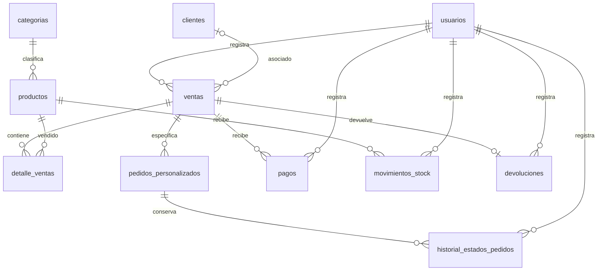

# Guía 6 — Modelo de datos de Melanova

Actualización documental: 11/11/2026. Este modelo describe el código y los SQL del ZIP; no es una exportación ni certificación del esquema remoto. Los tipos, valores predeterminados y restricciones completos deben obtenerse del respaldo de Supabase.

## Tablas y campos utilizados

| Tabla | Identificador | Información principal y relaciones |
| --- | --- | --- |
| categorias | id_categoria | nombre, descripcion opcional. Clasifica productos. El administrador crea o renombra mediante guardar_categoria_segura. |
| productos | id_producto | id_categoria → categorias.id_categoria; nombre, precio, existencia, fecha_registro según el modelo base. Muebles de catálogo. |
| clientes | id_cliente | nombre, contacto, direccion opcional. Se utiliza al registrar pedidos; el formulario actual de venta de stock no permite elegir cliente. |
| usuarios | id_usuario | id_auth → auth.users.id; nombre, correo, rol, contacto y fecha_registro según el modelo base; whatsapp_recuperacion para publicar voluntariamente el teléfono de ayuda. |
| ventas | id_venta | id_usuario → usuarios.id_usuario; id_cliente → clientes.id_cliente; fecha_venta, tipo_venta, total, estado_pago. Es la cabecera tanto de ventas de stock como de pedidos. |
| detalle_ventas | id_detalle | id_venta → ventas.id_venta; id_producto → productos.id_producto; cantidad, precio_unitario, subtotal. Contiene muebles de ventas de stock. El nombre real es plural. |
| pedidos_personalizados | id_pedido | id_venta → ventas.id_venta; descripcion_mueble, medidas, color_melamina, cantidad, precio_unitario, subtotal, estado_taller, fecha_entrega_estimada. Una fila por mueble especificado en el pedido. |
| pagos | id_pago | id_venta → ventas.id_venta; id_usuario → usuarios.id_usuario; monto, metodo_pago, tipo_pago, fecha_pago y solicitud_id. Movimientos de dinero recibido. |
| historial_estados_pedidos | id_historial | id_pedido → pedidos_personalizados.id_pedido; id_usuario → usuarios.id_usuario; estado_anterior, estado_nuevo, fecha_cambio. |
| movimientos_stock | id_movimiento | id_producto → productos.id_producto; id_usuario → usuarios.id_usuario; solicitud_id, tipo, cantidad, existencia_anterior, existencia_nueva, motivo, fecha_movimiento. El flujo incluido registra reposiciones. |
| devoluciones | id_devolucion | id_venta → ventas.id_venta; id_usuario → usuarios.id_usuario; solicitud_id, monto, metodo_devolucion, motivo, fecha_devolucion. El SQL limita a una devolución completa por operación en este flujo. |
| historial_recuperaciones_mueblex | id | fecha, operacion, tipo, id_cuenta, nombre_cuenta, correo_cuenta, id_responsable, nombre_responsable. Conserva los UUID de Auth y nombres históricos; el SQL incluido no declara claves foráneas para esos UUID. Nunca guarda contraseñas. |

Son doce tablas públicas de negocio identificadas en el código y las mejoras SQL. auth.users pertenece a Authentication y no se gestiona como una tabla pública de clientes. El esquema privado mueblex_respaldo guarda definiciones previas de funciones; no es otra tabla del negocio ni un respaldo completo.

## Campos adicionales de ventas

- Reintentos: solicitud_id y solicitud_datos. Se conserva la referencia para reconocer una operación ya procesada.
- Inventario: stock_descontado, stock_reintegrado y detalle_reintegro_stock.
- Anulación: estado_operacion, motivo_anulacion, fecha_anulacion e id_usuario_anulacion → usuarios.id_usuario.
- Entrega: modalidad_entrega, direccion_entrega, referencia_entrega, nombre_receptor, contacto_receptor y entrega_version.

Los datos de entrega se guardan en ventas, la cabecera de la operación; no sustituyen automáticamente la dirección del cliente. entrega_version detecta modificaciones concurrentes.

## Valores utilizados por la aplicación

- tipo_venta: directa_stock / pedido_medida.
- estado_operacion: activa / anulada.
- estado_pago: pendiente / anticipo_cobrado / pagado.
- estado_taller: pendiente → en_fabricacion → listo → entregado. La pantalla traduce en_fabricacion a texto legible; no utiliza en_taller como valor persistido.
- modalidad_entrega: retiro_tienda / domicilio según la validación de entrega incluida; confirmar el valor exacto con la función SQL al instalar.
- tipo de recuperación: restablecimiento / cambio_completado.

Los importes almacenados son numéricos; las funciones comerciales reciben centavos enteros cuando así lo exige su contrato. No guardar contraseñas en estas tablas.

## Relaciones

- categorias.id_categoria ← productos.id_categoria: una categoría clasifica varios muebles.
- usuarios.id_usuario ← ventas.id_usuario: un integrante del personal registra varias operaciones.
- clientes.id_cliente ← ventas.id_cliente: un cliente puede tener varios pedidos u operaciones asociadas.
- ventas.id_venta ← detalle_ventas.id_venta → productos.id_producto mediante id_producto: una venta de stock puede incluir varios muebles.
- ventas.id_venta ← pedidos_personalizados.id_venta: un pedido puede contener varias especificaciones de muebles.
- ventas.id_venta ← pagos.id_venta: una operación puede recibir varios pagos.
- pedidos_personalizados.id_pedido ← historial_estados_pedidos.id_pedido: historial de fabricación.
- productos.id_producto ← movimientos_stock.id_producto: historial de reposiciones.
- ventas.id_venta ← devoluciones.id_venta: devolución del flujo de anulación.

## Diagrama lógico actual

El diagrama representa relaciones lógicas del código. No añade restricciones ni reemplaza el DDL remoto. El historial de recuperación conserva instantáneas de cuenta y responsable; no se dibujan claves foráneas inexistentes.

## Alcance y límites

Las ventas de stock descuentan inventario; los pedidos no descuentan el catálogo. Los pagos y devoluciones son movimientos separados del total vendido. No se calcula ganancia porque no existe un módulo de costos y gastos.

La estructura admite relacionar clientes y ventas, pero el formulario actual de stock no solicita cliente. Por eso no se puede prometer un análisis completo de compras por cliente hasta implementar esa asociación en interfaz y servidor. Los pedidos sí utilizan cliente.

Los diagramas de etapas anteriores en diagramas/ son antecedentes. Para restaurar el sistema hace falta exportar el esquema vigente, incluidas funciones, triggers, RLS, permisos y Auth; véase [respaldo-y-pendientes-melanova.md](respaldo-y-pendientes-melanova.md).
