# Manual de usuario — Melanova

**Dirección del sistema:** https://mela-nova.netlify.app

Actualización de instrucciones: 11/11/2026. La interfaz actual utiliza Melanova.
Las capturas conservadas muestran pruebas de etapas anteriores y pueden mostrar
MUEBLEX u otra distribución. Sus cantidades y operaciones son ejemplos, no datos
reales del negocio. Pendiente renovar las capturas al aprobar el diseño definitivo.

## 1. Entrar y salir del sistema

1. Abre la dirección del sistema en tu navegador.
2. Escribe el correo de tu cuenta y tu contraseña.
3. **Recordarme empieza desactivado.** Actívalo solo si quieres conservar el acceso en ese navegador. El ojo del campo Contraseña permite mostrar u ocultar lo escrito; no cambia tu contraseña.
4. Pulsa **Ingresar** y espera a que aparezca el inicio.
5. Al terminar, pulsa **Cerrar sesión** en el menú lateral.

Si aparece **Crea tu nueva contraseña**, completa el procedimiento de la sección 3
antes de utilizar las demás pantallas.

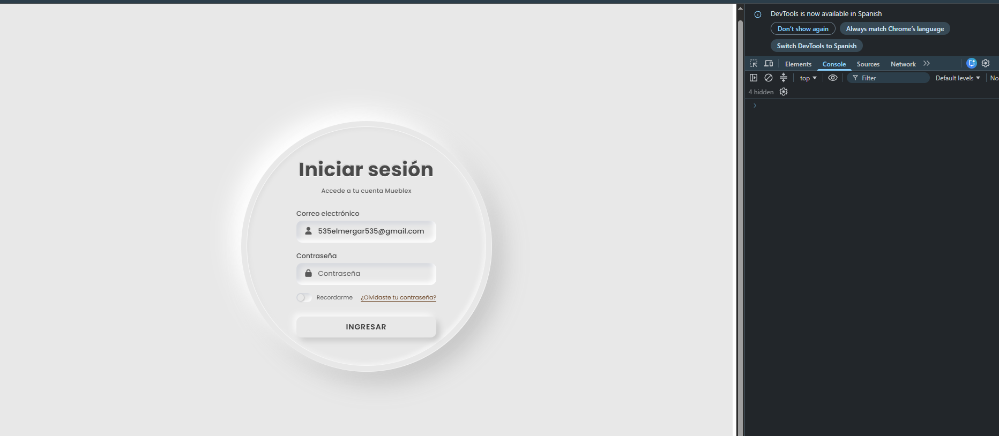

## 2. Solicitar ayuda si olvidaste la contraseña

1. En el inicio de sesión pulsa **¿Olvidaste tu contraseña?**.
2. Escribe el correo de tu cuenta.
3. Elige al administrador que quieras contactar.
4. Pulsa **Preparar mensaje** y después **Abrir WhatsApp**.
5. Revisa el destinatario y pulsa **Enviar** dentro de WhatsApp.
6. El administrador verificará tu identidad antes de ayudarte.

Preparar el mensaje no significa que se haya enviado. Si no hay administradores
publicados, contacta al responsable del negocio por tu medio habitual.

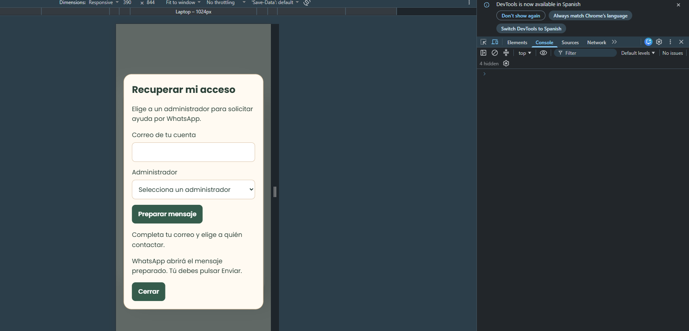

## 3. Sustituir una contraseña temporal

1. Entra con el correo de tu cuenta y la contraseña temporal que te entregó el administrador.
2. En **Crea tu nueva contraseña**, escribe la contraseña temporal.
3. Escribe una nueva contraseña distinta en los otros dos campos, de al menos 12 caracteres.
4. Pulsa **Guardar y volver a iniciar sesión**.
5. Entra de nuevo con tu contraseña personal. La temporal deja de servir.

No compartas tu contraseña personal con el administrador ni con otras personas.
Si cierras sesión sin terminar el cambio, tendrás que completarlo al volver a entrar.

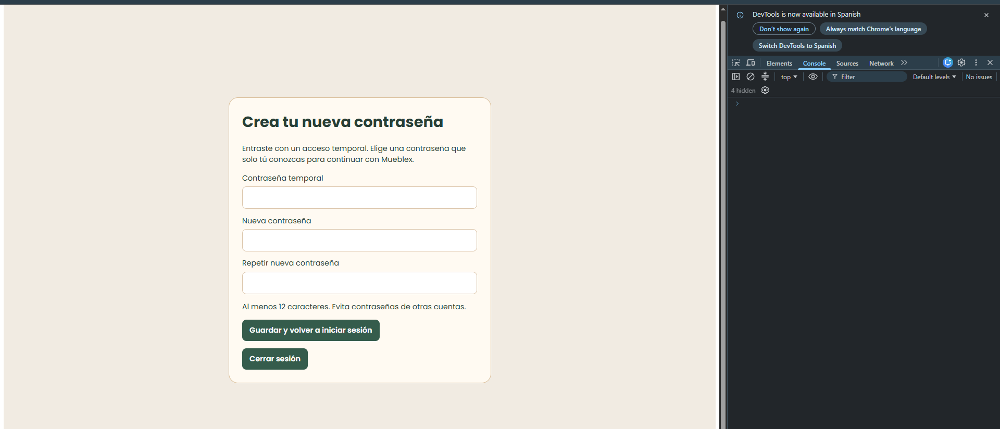

## 4. Utilizar el menú y el buscador

- **Inicio:** resumen de actividad y accesos rápidos.
- **Inventario:** muebles, existencias y, para administradores, registro y reposición.
- **Ventas:** venta de muebles disponibles e historial de ventas.
- **Pedidos:** muebles por fabricar, cobros y seguimiento de su entrega.
- **Clientes:** datos de los clientes.
- **Reportes:** consulta de ventas y cobros.
- **Administración:** funciones administrativas y cambio de tu propia contraseña.

En un celular, abre **Menú** para cambiar de sección. El buscador superior permite
buscar muebles, clientes y ventas. Escribe al menos dos caracteres y pulsa **Buscar**.
Puedes buscar por nombre, teléfono, número de venta (por ejemplo V-22) o fecha (AAAA-MM-DD). La ayuda puede estar oculta en Inicio para aprovechar el espacio.

Los administradores ven controles que los vendedores no tienen. Si una acción no
está disponible para tu cuenta, solicita ayuda a un administrador.

## 5. Consultar existencias

1. Abre **Inventario**.
2. En **Consultar existencia de muebles**, utiliza **Buscar en muebles** para filtrar por el texto de las filas. Pulsa **Limpiar** para volver a verlas y **Actualizar** para consultar de nuevo. Usa **Anteriores / Siguientes**: se muestran ocho filas por página.
3. Revisa su precio, existencia y estado.

- **Agotado:** no tiene unidades disponibles.
- **Stock bajo:** tiene entre 1 y 3 unidades.
- **Disponible:** tiene más de 3 unidades.

Consultar esta lista no reserva unidades. Comprueba el resultado de la venta antes
de prometer que una unidad quedó vendida.

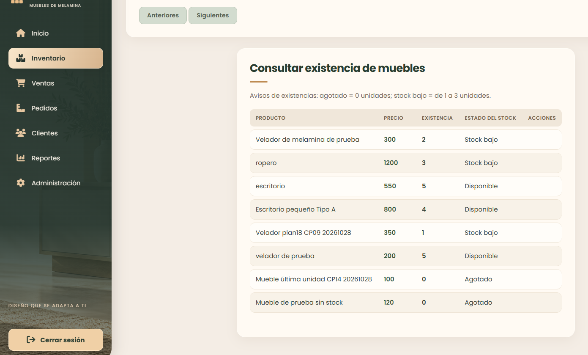

## 6. Registrar un mueble y reponer unidades — Administrador

### Registrar un mueble nuevo

1. Abre **Inventario → Registrar mueble**.
2. Escribe el nombre y selecciona una categoría.
3. Introduce un precio mayor que cero y la existencia inicial real.
4. Pulsa **Registrar mueble** una sola vez.
5. Espera la confirmación y comprueba que aparece en el inventario.

### Ingresar unidades de un mueble existente

1. En **Reponer existencias**, selecciona el mueble.
2. Revisa la existencia consultada.
3. Escribe cuántas unidades ingresan y el motivo del ingreso.
4. Pulsa **Registrar ingreso de stock**.
5. Revisa la nueva existencia y el **Historial de reposiciones**.

Para añadir unidades utiliza la reposición; el formulario de precio no permite
modificar la existencia.

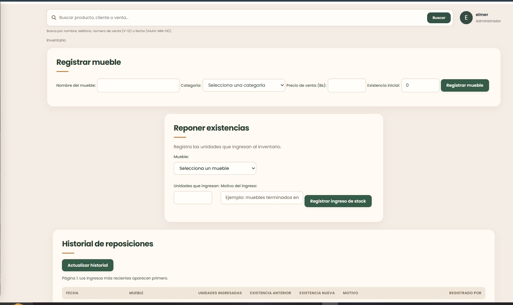

## 7. Cambiar el precio de un mueble — Administrador

1. En el inventario, pulsa **Editar precio** en el mueble correcto.
2. Escribe el nuevo precio, mayor que cero.
3. Pulsa **Guardar cambios** y espera la confirmación.
4. Comprueba el precio en la lista. **Cancelar edición** descarta la edición abierta.

Si otra persona cambió el mismo precio, actualiza la lista y revisa el valor vigente
antes de repetir tu cambio.

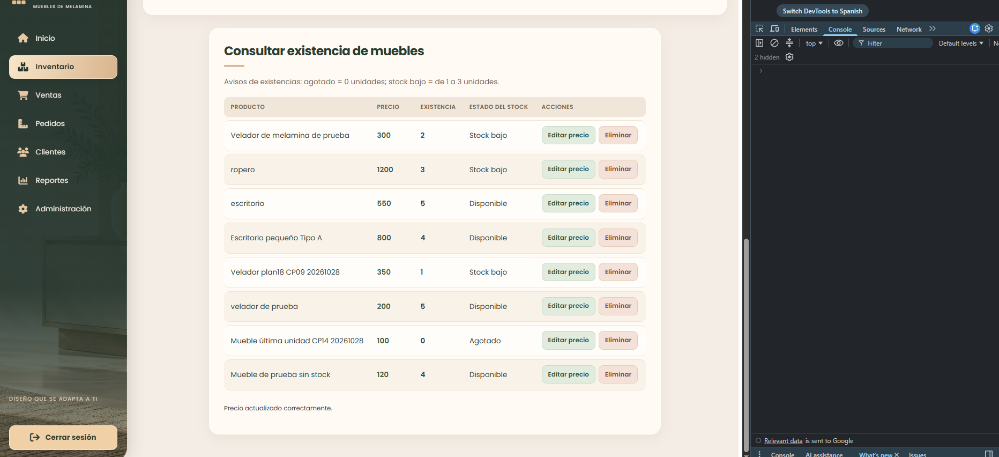

## 8. Registrar y editar clientes

1. Abre **Clientes → Registrar cliente**.
2. Completa nombre y teléfono. Añade la dirección si corresponde.
3. Pulsa **Registrar cliente** y espera la confirmación.
4. Para corregir sus datos, localiza al cliente, pulsa **Editar**, realiza el cambio
   y pulsa **Guardar cambios**.

La eliminación de clientes corresponde al administrador. Si un cliente tiene
operaciones relacionadas, solicita una revisión antes de intentar eliminarlo.

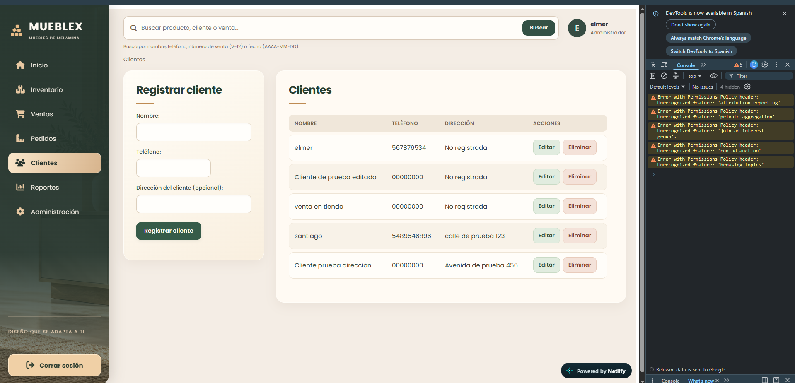

## 9. Registrar una venta de muebles disponibles

1. Abre **Ventas** y selecciona un mueble.
2. Escribe la cantidad y pulsa **Agregar mueble**.
3. Repite para otros muebles si corresponde. **Quitar** elimina una línea todavía no confirmada.
4. Revisa cantidades, precios, subtotales y total.
5. Pulsa **Confirmar venta** una sola vez y espera el resultado.
6. Anota el número confirmado y abre su **Ver detalle** desde el historial.
7. Comprueba que las existencias se actualizaron.

La venta descuenta unidades, pero **no registra automáticamente un pago**. Si
recibiste dinero, utiliza el registro de pago explicado en la sección 11.

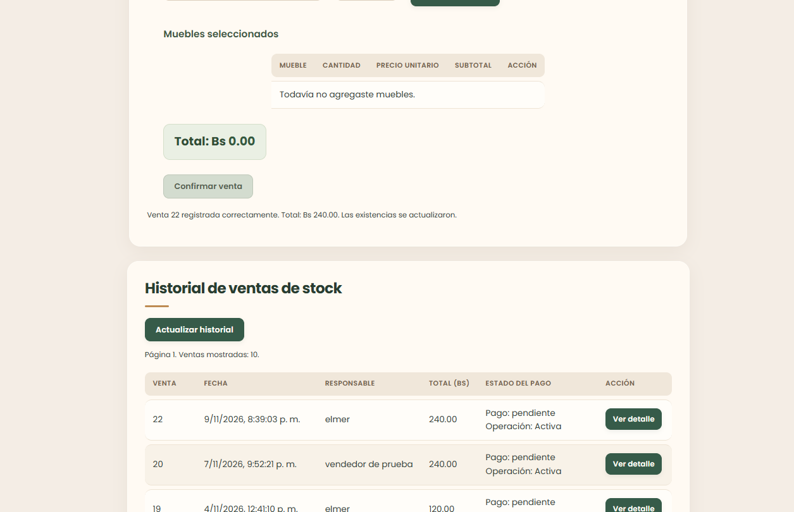

### Revisar una venta e imprimir su comprobante

1. En **Historial de ventas**, pulsa **Actualizar historial** si hace falta.
2. Localiza la venta por su número y pulsa **Ver detalle**.
3. Revisa muebles, responsable, total, cobros y saldo.
4. Para imprimir, pulsa **Imprimir comprobante** y elige la impresora o guardar como PDF.
5. Pulsa **Cerrar detalle** al terminar.

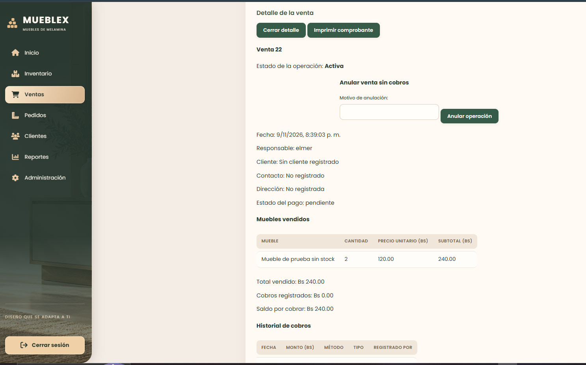

## 10. Registrar un pedido a medida

1. Si el cliente es nuevo, regístralo primero en **Clientes**.
2. Abre **Pedidos** y selecciona al cliente.
3. Escribe descripción, alto, ancho y profundidad en centímetros, color, cantidad,
   precio acordado por unidad y fecha estimada de entrega.
4. Pulsa **Agregar mueble a medida**. Repite si el pedido tiene varios muebles.
5. Revisa el total y el monto recibido al registrar. Escribe cero si no recibiste dinero.
6. Si recibiste un anticipo o pago completo, indica el importe y su método.
7. Revisa el saldo y pulsa **Registrar pedido a medida** una sola vez.
8. Espera la confirmación y revisa el detalle en el historial.

Los pedidos a medida se fabrican para el cliente: no descuentan muebles del
inventario de exhibición al registrarse. El monto recibido no puede superar el total.

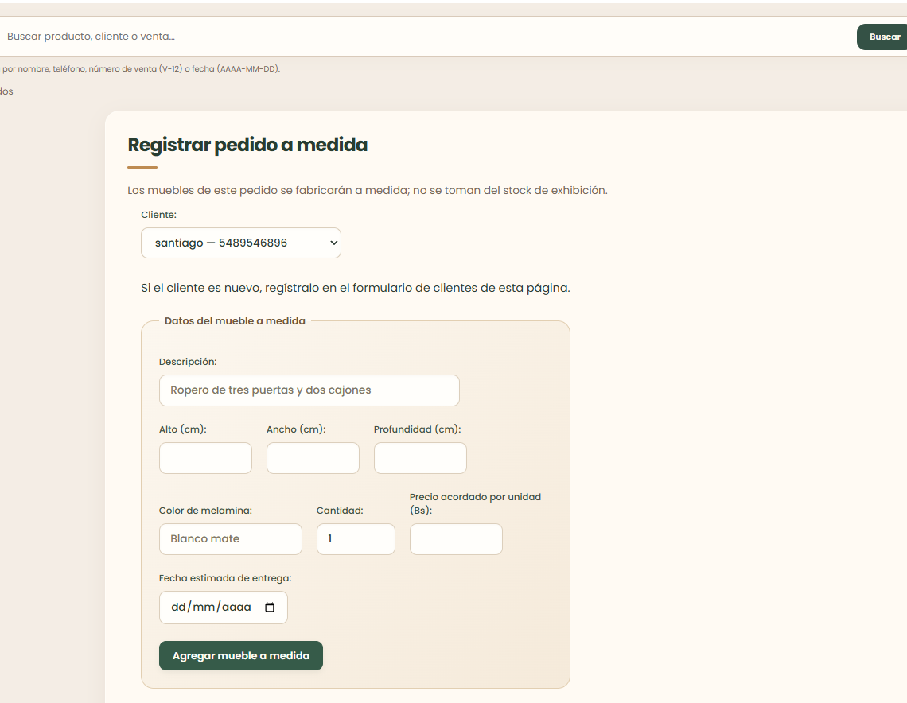

## 11. Registrar pagos y consultar el saldo

1. Abre el detalle de la venta o pedido correcto.
2. Comprueba el número de operación y el **Saldo disponible para cobrar**.
3. Escribe el **Monto recibido** y elige **Efectivo**, **QR** o **Transferencia**.
4. Pulsa **Registrar pago** una sola vez.
5. Revisa el nuevo saldo y la nueva fila del historial de cobros.

Seleccionar QR o transferencia **registra el método de un dinero ya recibido**;
no cobra automáticamente ni confirma por sí mismo una transferencia bancaria.
Registra únicamente el importe que realmente recibiste.

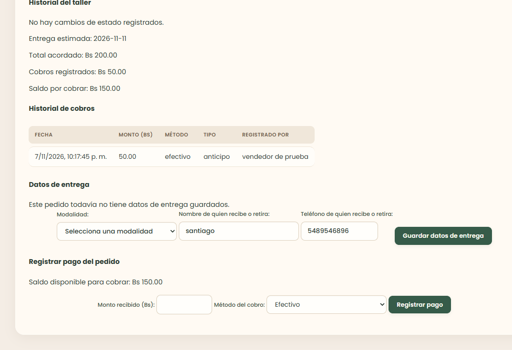

## 12. Seguir la fabricación y preparar la entrega

1. Abre **Pedidos → Historial de pedidos a medida → Ver detalle**.
2. Revisa el estado de cada mueble.
3. Usa **Iniciar fabricación**, **Marcar como listo** y **Marcar como entregado**
   cuando el trabajo haya avanzado realmente a esa etapa.
4. Revisa el historial del taller para consultar los cambios registrados.
5. En **Datos de entrega**, elige retiro en tienda o entrega a domicilio.
6. Completa quién recibe, su teléfono y, si es a domicilio, la dirección y referencia.
7. Pulsa **Guardar datos de entrega** y comprueba la confirmación.

Si el sistema impide avanzar, lee el mensaje y completa lo solicitado antes de
repetir. Los datos de entrega se guardan en la operación que está abierta.

En el detalle también puedes utilizar **Imprimir comprobante** o
**Imprimir nota para el taller**, según lo que necesites entregar.

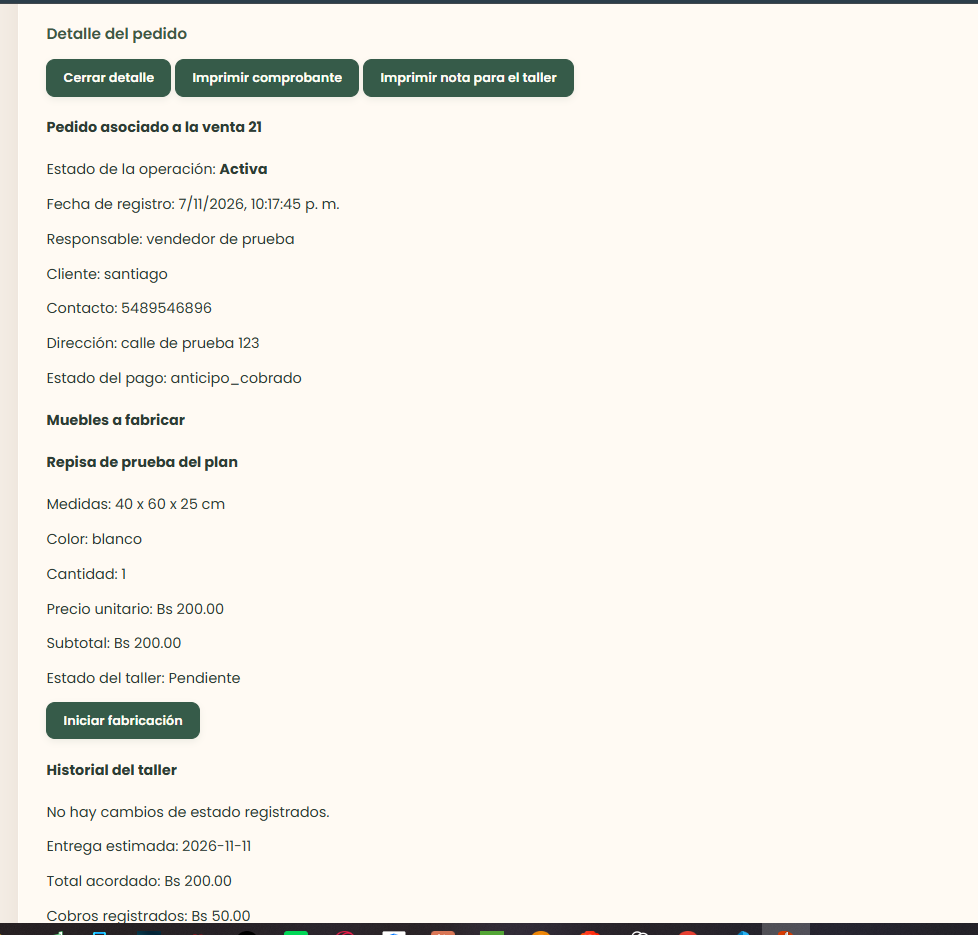

## 13. Consultar reportes

1. Abre **Reportes**.
2. Selecciona las fechas Desde y Hasta y pulsa **Consultar ventas**.
3. Revisa los importes y sus descripciones antes de usarlos para tomar decisiones.
4. Pulsa **Consultar muebles más vendidos** para ver las unidades de catálogo
   vendidas en todo el historial, sin ese filtro de fechas.

El **valor vendido** y el **dinero cobrado** no son lo mismo. El neto cobrado resta
las devoluciones de dinero. Estos importes no representan por sí solos la ganancia:
el sistema no calcula allí todos los costos y gastos del negocio.

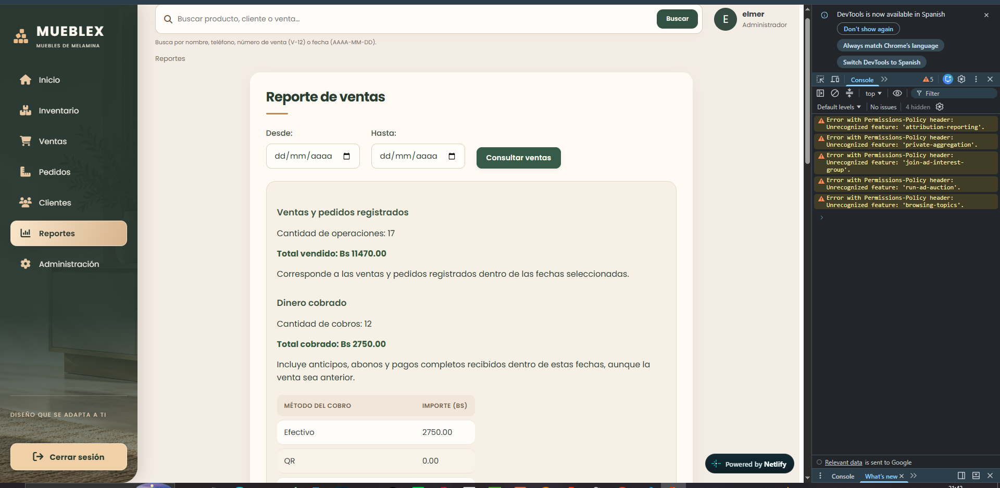

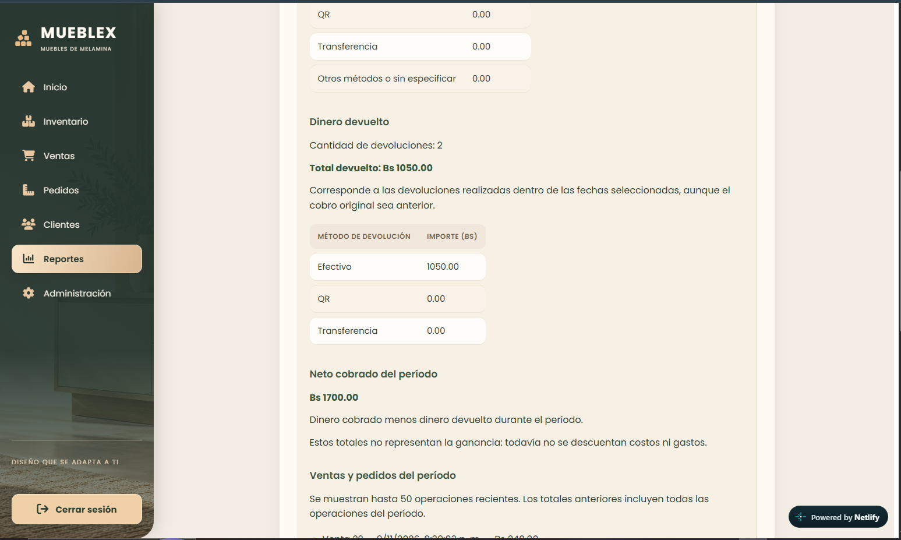

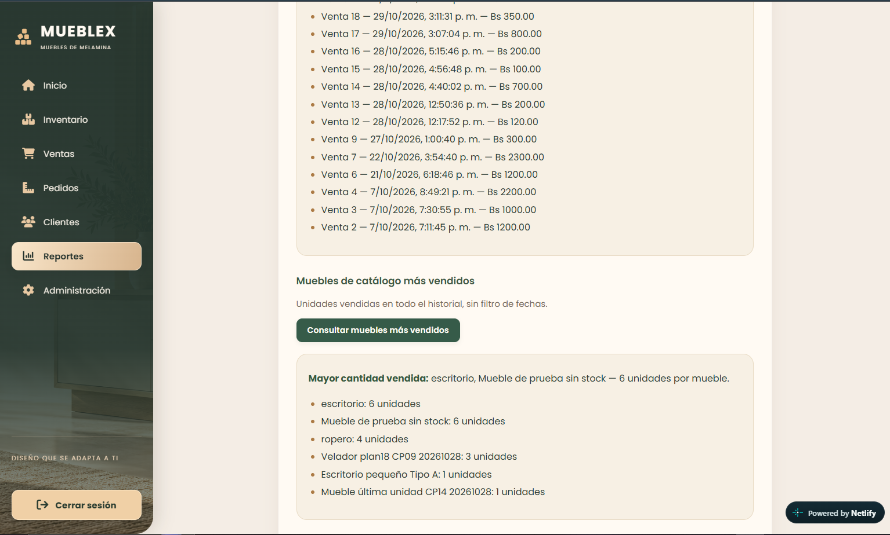

## 14. Administrar categorías — Administrador

1. Abre **Administración → Administrar categorías**.
2. Escribe el nombre y pulsa **Crear categoría**.
3. Para renombrarla, pulsa **Editar**, escribe el nombre corregido y guarda.
4. Comprueba el nombre en la lista y en el selector de Inventario.

Cambiar el nombre conserva los muebles que ya pertenecen a esa categoría.
Si el nombre ya existe, revisa la lista antes de intentar crearlo otra vez.

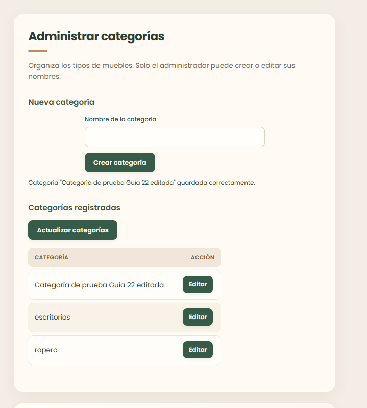

## 15. Crear cuentas del personal — Administrador

1. Abre **Administración → Administrar usuarios**.
2. Completa nombre, correo, contacto, contraseña inicial y rol.
3. Elige **Vendedor** para quien realizará operaciones habituales; utiliza
   **Administrador** solo para quien deba gestionar también los controles administrativos.
4. Pulsa **Registrar nuevo usuario** y espera la confirmación.
5. Entrega el acceso de forma privada y pide cambiar la contraseña desde su cuenta.

El cambio obligatorio de la recuperación se aplica a los accesos restablecidos.
No se debe suponer que el alta actual obliga por sí sola a cambiar la contraseña inicial.

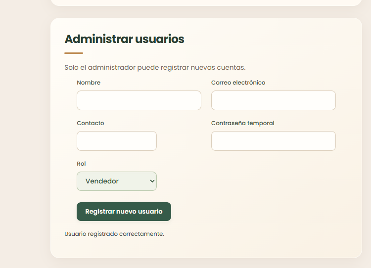

## 16. Ayudar a recuperar una cuenta — Administrador

### Publicar un WhatsApp de ayuda

1. Abre **Administración → Acceso de los usuarios**.
2. Busca la cuenta de administrador y pulsa **WhatsApp de ayuda**.
3. Escribe código de país y número, solo dígitos, y guarda.
4. El nombre y ese número estarán visibles desde **¿Olvidaste tu contraseña?**.
5. Para retirar el contacto, deja el campo vacío y guarda.

### Restablecer la contraseña de otra cuenta

1. Verifica la identidad de la persona por un medio conocido. Un mensaje con un
   correo no demuestra por sí solo que sea propietaria de la cuenta.
2. Busca su nombre o correo y pulsa **Restablecer contraseña**.
3. Escribe dos veces una contraseña temporal nueva y marca la confirmación de identidad.
4. Pulsa **Restablecer acceso** y revisa el resultado.
5. Entrega la temporal en privado. La persona debe seguir la sección 3 al entrar.
6. Consulta **Historial de recuperación** para revisar el restablecimiento y el cambio completado.

El panel no permite ver la contraseña anterior ni consultar una temporal después
de guardarla. Para cambiar la tuya usa **Cambiar contraseña**.

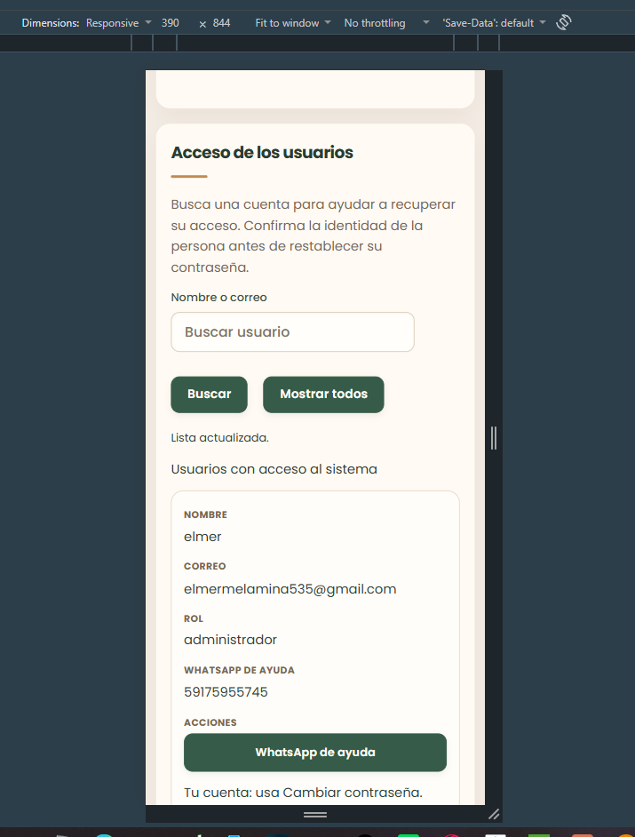

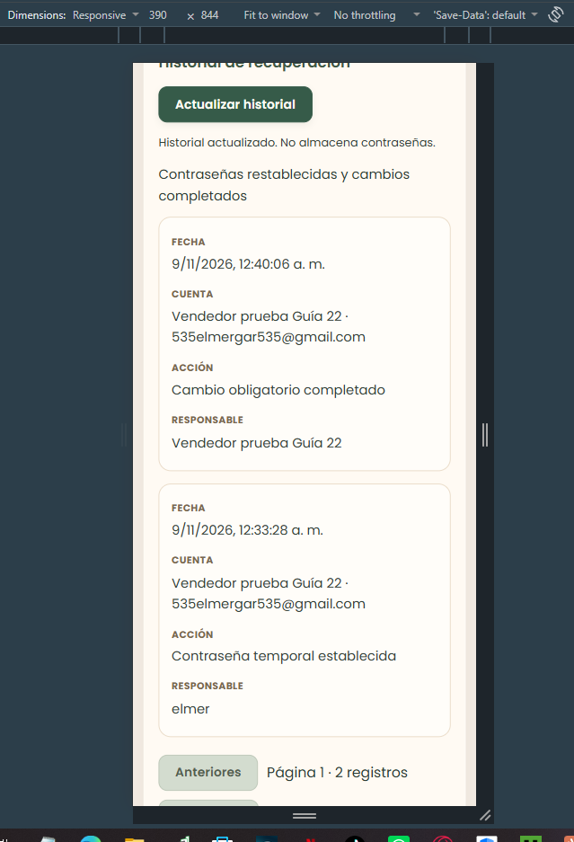

## 17. Anular operaciones y registrar devoluciones — Administrador

1. Abre el detalle de la venta o pedido correcto y revisa número, estado y cobros.
2. Si no tiene cobros y aparece **Anular operación**, escribe el motivo y confirma
   únicamente después de revisar los datos.
3. Si tiene cobros y aparece **Anular y registrar devolución completa**, revisa
   el importe, método y motivo. Registra aquí dinero que ya devolviste al cliente.
4. Completa las confirmaciones que muestra el formulario. En una venta de stock,
   confirma la recepción de los muebles recuperados cuando corresponda.
5. Espera la confirmación y vuelve a revisar el detalle y el inventario.

La función disponible contempla devolución completa; no debe usarse como si
permitiera una devolución parcial. Si el estado del pedido impide la anulación,
solicita revisión del responsable en vez de eliminar el historial.

Si se corta la conexión, revisa primero si la operación quedó registrada antes
de devolver dinero o confirmar nuevamente.

## 18. Cambiar tu contraseña y resolver problemas habituales

Para cambiar una contraseña que conoces, entra en **Administración → Cambiar
contraseña**, escribe dos veces una nueva de al menos 12 caracteres y guarda.
Después cierra sesión y comprueba el acceso con la nueva.

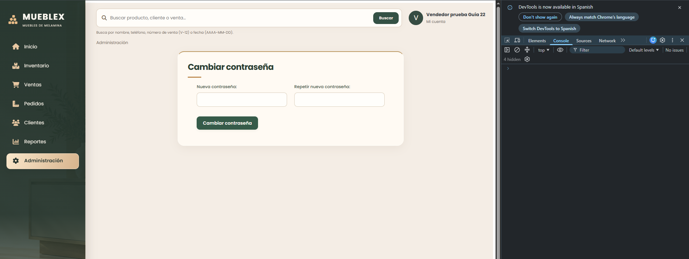

| Situación | Qué hacer |
| --- | --- |
| No puedo entrar | Comprueba correo y contraseña. Si la olvidaste, utiliza el contacto por WhatsApp. |
| Me pide cambiar una contraseña temporal | Completa los tres campos de la pantalla de cambio obligatorio. |
| No aparece un botón administrativo | Comprueba con qué cuenta entraste y consulta a un administrador. |
| No hay existencias suficientes | Actualiza el inventario y revisa la cantidad disponible. |
| El botón de confirmar está deshabilitado | Completa los datos y agrega al menos un mueble válido a la lista. |
| La conexión se interrumpió al guardar | Revisa el historial antes de repetir una venta, pedido, pago o devolución. |
| Aparece un botón para confirmar una operación pendiente | Utiliza la recuperación que muestra la pantalla antes de iniciar otra operación equivalente. |
| No hay administrador disponible para recuperar acceso | Contacta al responsable de la instalación del negocio. |

En móvil, los usuarios y su historial de recuperación aparecen como tarjetas.
En otras tablas anchas, desliza la tabla horizontalmente para ver más columnas.

Si necesitas ayuda, comparte el mensaje de error y el número de operación con
el responsable. No compartas contraseñas ni confirmes de nuevo un cobro sin revisar
si ya aparece en su historial.

## 19. Entender el resumen de Inicio

- **Ventas de hoy:** valor registrado en ventas y pedidos activos del día; no significa dinero recibido.
- **Saldo por cobrar:** diferencia entre total y cobros de operaciones activas.
- **Muebles con stock bajo:** cantidad de muebles con entre cero y tres unidades; incluye agotados.
- **Pedidos por entregar:** pedidos activos con al menos un mueble sin entregar.
- **Gráfico semanal:** valor vendido de operaciones activas de los últimos siete días.
- **Últimas ventas y próximas entregas:** accesos de consulta; abrir sus secciones para realizar cambios.

Pulsa **Actualizar resumen** para consultar de nuevo. Un fallo de consulta no debe interpretarse como ausencia de operaciones.

## 20. Buscar y recorrer clientes

En **Clientes**, escribe en la búsqueda local, usa **Limpiar** para quitar el filtro y **Actualizar** para consultar de nuevo. El listado muestra ocho filas por página; utiliza **Anteriores / Siguientes**. El buscador superior busca en varias secciones y no reemplaza estos controles locales.

## 21. Alcance de las capturas

Las figuras 1 a 21 se conservan para explicar las tareas y mantener la evidencia. No son una garantía visual del diseño de noviembre actualizado. Su sustitución por capturas nuevas se realizará después de comprobar el ZIP en el navegador; no hace falta crear ventas reales para actualizar imágenes de formularios.
